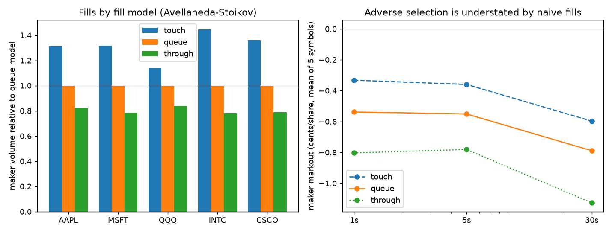
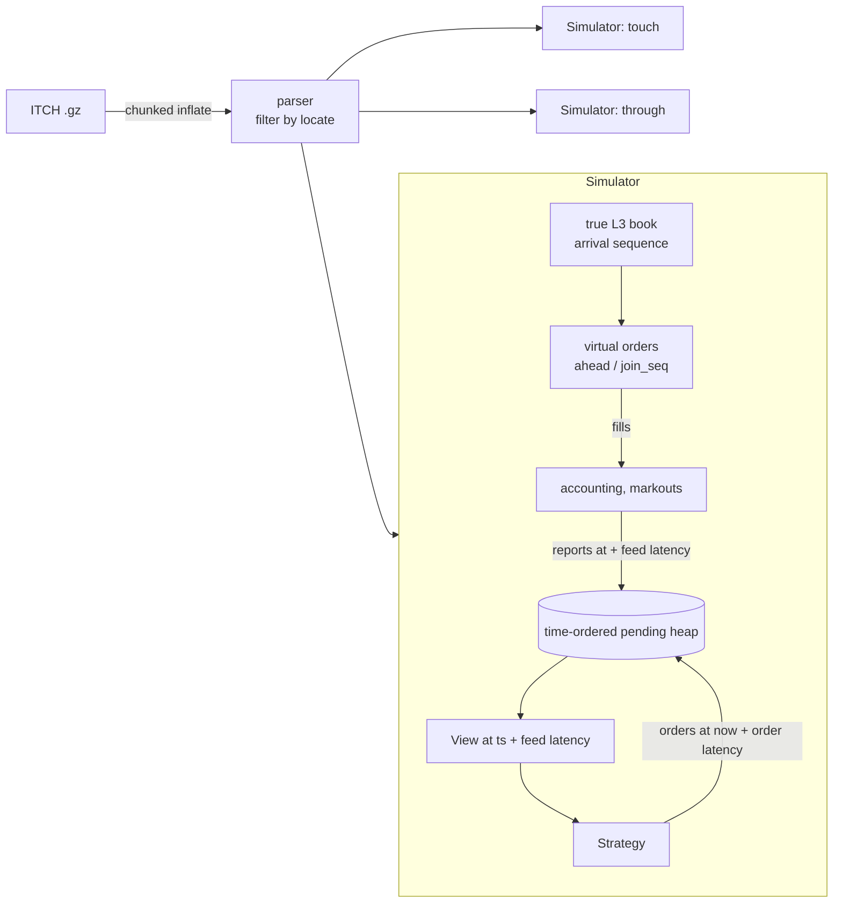

# queuesim

An event-driven L3 backtester in C++20 that models the queue position of passive orders. It
replays a full day of NASDAQ TotalView-ITCH order-by-order data, places a strategy's virtual
orders at the back of the real queue, and fills them only when the L3 events ahead of them say
they would have traded. It includes configurable feed and order latency, maker rebates and taker
fees, markouts, and a look-ahead barrier. A side-by-side comparison measures how naive fill
assumptions distort results.

[](https://github.com/eshaan2418/queuesim/actions/workflows/ci.yml)


> Educational/research project. Not investment advice. No live trading. One historical day; the
> strategies shown are examples, not recommendations.

## Headline results

NASDAQ ITCH sample, 2019-01-30 (368M messages), five liquid names, Apple M5 Pro. Raw JSON:
[`research/results/20261102-020741/`](research/results/20261102-020741/SUMMARY.md).

| finding | measurement |
|---|---|
| Naive "fill on touch" overstates fills | **1.24-1.54×** the queue model's fill count on every symbol (maker volume 1.14-1.45×) |
| ...and understates adverse selection | 1 s maker markout **0.13-0.24 ¢/share too favourable** on every symbol |
| Avellaneda-Stoikov maker under realistic queue fills | negative markouts at 1 s / 5 s / 30 s on all five names; small positive PnL on MSFT/INTC/CSCO ($87-603; rebates add $38-299), losses on AAPL (earnings-day trend) and QQQ |
| Latency 5 µs → 5 ms (MSFT) | more fills (stale quotes picked off), 1 s markout −0.54 → −0.60 ¢ |
| Top-of-book imbalance taker | loses at θ = 0.6/0.8/0.9 on AAPL and MSFT: markouts worse than the half-spread paid |
| Look-ahead violations | **0** across all runs and tests |
| Determinism | rerun gives identical fill hashes and PnL |
| Speed | full day, all three fill models in one pass: 15-28 s (zlib-bound) |



## Demo

`make demo` (MSFT, Avellaneda-Stoikov, all fill models; `research/results/demo_output.txt`):

```
MSFT: replayed 368,366,634 ITCH messages (1,653,562 for the symbol) in 25.4 s
model       fills  maker vol      PnL $  markout 1s c/sh
queue       1,880    150,933        603            -0.55
touch       2,699    198,740        422            -0.33
through     1,304    118,295        328            -0.79
```

## Why it matters

Most backtests of passive strategies assume a resting order fills when the market trades at its
price. On a price-time venue that is false. Your order sits behind everyone who was there first,
and the fills you do get are skewed toward the moments the level is swept, when the price is
about to move against you. Get queue position wrong and a backtest overstates fill rates, hides
adverse selection, and misprices the maker rebate economics, which is exactly how market-making
strategies that "work" in backtests lose money live. L3 data (every order, with its id) is what
makes the queue observable, and this project uses it.

## Highlights

- **Exact queue accounting from L3.** Every resting order carries an arrival sequence. Our
  virtual order knows which shares are ahead of it, and is filled by executions of orders behind
  it, by trade-throughs, and by crossing arrivals. Three fill models (queue, touch, through) run
  in a single pass over the data.
- **Latency and no look-ahead by construction.** The strategy sees only delayed views and delayed
  fill reports, and its orders act after the order latency. Every delivery is checked, with 0
  violations.
- **A test-caught bug.** Event-ordering (applying an event before earlier-timestamped order
  arrivals) let an order see the future. A scripted scenario caught it, and results were
  regenerated after the fix.
- **Property tests on random L3 flows:**
  - fills(touch) ≥ fills(queue) ≥ fills(through) for a non-reactive strategy;
  - deterministic replay;
  - no look-ahead at any latency;
  - accounting consistency.
- **Strategy research outputs:** PnL with and without fees, inventory, fill rate, 1 s / 5 s /
  30 s markouts (maker and taker), an equity curve and a Sharpe ratio (with the caveats it
  deserves).

## Quick start

```bash
make build test                       # build + tests (GoogleTest)
make data                             # NASDAQ ITCH sample (4.7 GB, SHA-256 pinned), shared with itchbook
make demo                             # MSFT market maker under all three fill models
make bench                            # full experiment suite (~8 min)

build/queuesim --itch FILE --symbol AAPL --strategy as  --model all --feed-us 50 --order-us 50 \
               --gamma 0.1 --kappa 150 --tau 30 --lot 100 --max-lots 5 --out aapl.json
build/queuesim --itch FILE --symbol MSFT --strategy imb --model queue --theta 0.8 --hold-s 5
```

## Architecture



Event ordering and the information barriers are described in [`docs/DESIGN.md`](docs/DESIGN.md).
The microstructure (queue position, adverse selection, markouts, Avellaneda-Stoikov, fees) is
in [`docs/MICROSTRUCTURE.md`](docs/MICROSTRUCTURE.md).

## Correctness

| test | checks |
|---|---|
| `QueueModel.FillsOnlyAfterQueueAheadIsConsumed` | ahead executions and cancels reduce the queue; an execution of an order behind us fills us; exact share counts |
| `QueueModel.Touch…` / `Through…` | the same scenario fills 100 / 0 shares under the naive / pessimistic models |
| `QueueModel.TradeThroughAndCrossFill` | trades through our price and crossing arrivals fill us under every model |
| `QueueModel.OrderLatencyDelaysQueueEntry` | orders that arrive before ours (during our latency) are ahead of us (this caught the ordering bug) |
| `QueueModel.TakerWalksVisibleBookAtArrival` | market orders walk the visible book at arrival time, with taker fees |
| `SimProperty.FillModelOrdering…` | touch ≥ queue ≥ through on 8 random L3 flows, identical order flow |
| `SimProperty.DeterministicReplay`, `NoLookaheadAcrossLatencies`, `AccountingConservation` | as named |
| Real data | 0 look-ahead violations; identical rerun |

## Performance

A full day is 11.2 GB of ITCH, decompressed in 64 MiB chunks and filtered by stock locate. Only
the target symbol's ~1.7M messages drive the book and the simulators. Runs take 15-28 s,
dominated by single-threaded zlib. [itchbook](https://github.com/eshaan2418/itchbook) shows the
L3 book itself running at ~20M msgs/s. This backtester uses a simpler `std::map` book because
correctness and clarity matter more than speed here.

## Design decisions and trade-offs

| decision | chosen | rejected, and why |
|---|---|---|
| fill model | exact L3 queue accounting | probabilistic queue models from L2 (needed only without order ids) |
| market impact | none (virtual orders) | ad hoc impact (unverifiable without our own historical orders) |
| model comparison | all models in one pass | separate runs (3× the I/O; harder to compare) |
| look-ahead | delayed views + delayed reports + checked | trusting strategy code |
| strategy interface | virtual `Strategy`/`Ctx` | templates (no hot-path pressure here; clarity wins) |
| time horizon in A-S | fixed τ (30 s) | time-to-close (makes the inventory term meaningless intraday) |

## Limitations and roadmap

- One day of data; the results are illustrative, not statistically robust. Next: multi-day runs
  and walk-forward parameter selection on the distributed backtest grid.
- No market impact, hidden liquidity, auctions, or cancel-ack round trips.
- Multi-symbol portfolios and cross-asset signals.
- Hand the strategy API to [matchbox](https://github.com/eshaan2418/matchbox) for agent-based
  simulation with real matching.

## Related projects

- [itchbook](https://github.com/eshaan2418/itchbook): the ITCH parser and L3 book this builds on.
- [matchbox](https://github.com/eshaan2418/matchbox): price-time matching engine (the venue whose
  queue semantics are modelled here).
- [marketmux](https://github.com/eshaan2418/marketmux), [raftex](https://github.com/eshaan2418/raftex):
  the market-data and exchange-infrastructure side of the stack.

## Project structure

```
include/queuesim/  book.hpp (L3 + arrival seq) sim.hpp (event loop, queue model, accounting)
                   strategies.hpp (Avellaneda-Stoikov, imbalance taker) messages/parser/gz_reader (ITCH)
tools/             queuesim CLI
tests/             scripted queue scenarios, random-flow properties
scripts/, research/ experiment suite, summariser, plots, raw results
docs/              DESIGN, MICROSTRUCTURE, DEEP_DIVE
```

## License

MIT. See [LICENSE](LICENSE). Educational/research project. Not investment advice. No live trading.
NASDAQ ITCH sample data © Nasdaq, Inc.; downloaded from Nasdaq's public site, not redistributed.
